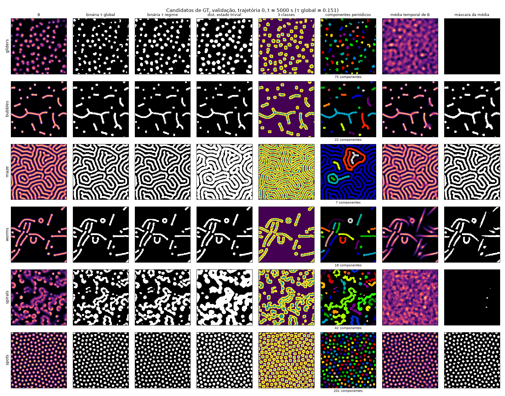
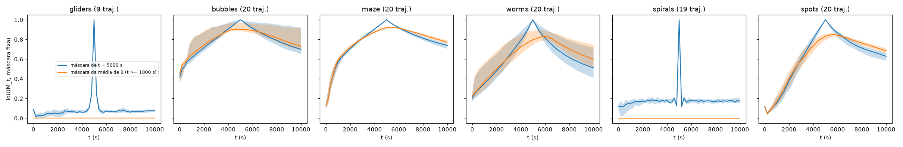

# Etapa 2: ficha de ground truth (Gray-Scott)

> Esta ficha **não escolhe** o ground truth. Ela apresenta as alternativas da
> Seção 0.4 e as interpretações de "frame médio" da Seção 0.9.4, com evidências
> numéricas, para a decisão da equipe e do professor.
>
> Reprodução: `MPLCONFIGDIR=.cache/mpl .venv/bin/python scripts/03_gt_candidates.py`.
> Números em [results/gt/candidatos.json](../results/gt/candidatos.json).
> Código dos candidatos: [src/ground_truth/candidates.py](../src/ground_truth/candidates.py).
>
> Dados: limiares ajustados em 16 trajetórias de treino por regime (frames 20, 40, ..., 1000,
> excluindo t = 0); efeitos medidos nas 20 trajetórias de validação. O teste não foi usado.

## 1. Fenômeno e variáveis

- Fenômeno: formação de padrões de Turing no sistema de reação-difusão de Gray-Scott.
  O estado homogêneo trivial (A, B) = (1, 0) é o "fundo"; os padrões são regiões em que B é alto e A é baixo.
- Variáveis disponíveis: apenas as concentrações escalares A e B, em 128 × 128 com contorno periódico. Não há velocidade.
- Objeto de segmentação proposto: as **regiões ocupadas pelo padrão** (pontos, listras, labirintos, espirais, planadores) em cada instante.

## 2. Alternativas de definição das classes

### Alternativa 1: binária por limiar de B

\[ M(x,y,t) = \mathbb{1}[B(x,y,t) > \tau] \]

Candidatos de τ (todos ajustados só no treino):

- τ₁ = Otsu global (seis regimes juntos): **0,151**. Sem os frames "mortos" (B ≡ 0): 0,154.
- τ₂ = Otsu por regime: Gliders 0,105; Bubbles 0,200; Maze 0,161; Worms 0,175; Spirals 0,126; Spots 0,154.
- τ₃ = critério físico alternativo: distância ao estado trivial, \( \sqrt{(1-A)^2 + B^2} > \tau_d \), com τ_d = Otsu = 0,359. Usa os dois campos.

O Otsu global cai no vale entre os dois modos de B na maioria dos regimes ([histogramas_B_limiares.png](figs/gt/histogramas_B_limiares.png)).

Sensibilidade (IoU entre as máscaras, na validação):

- τ global contra τ por regime: Spots 0,98; Maze 0,96; Worms 0,91; Bubbles 0,89; Spirals 0,86; Gliders 0,74.
- τ global contra distância ao estado trivial: de 0,58 (Spirals, Gliders) a 0,96 (Worms).

Fração de pixels de padrão com τ global: Gliders 5%, Bubbles 28%, Maze 52%, Worms 25%, Spirals 27% e Spots 26%.

### Alternativa 2: três classes (fundo, interior e interface)

- A interface é o gradiente morfológico periódico da máscara binária, com elemento 3 × 3.
- Distribuição das classes (fundo / interior / interface): Maze 20% / 22% / **58%**; Spots 45% / 7% / 48%; Gliders 90% / 2% / 8%.
- Limitação: as estruturas do Gray-Scott têm só de 4 a 8 pixels de largura. Com interface de 3 pixels, quase todo o padrão vira "interface" e o interior quase desaparece. Seria preciso uma interface de 1 pixel, ou outra definição (faixa de |∇B|).

### Alternativa 3: componentes conexos periódicos

- Usa a máscara binária com rotulação num toro (regiões que tocam uma borda continuam na oposta).
- Número de componentes em t = 5.000 s (média e faixa): Spots 201 (192 a 207); Worms 71 (13 a 125); Spirals 39 (0 a 60); Gliders 31 (0 a 75); Bubbles 10,5 (1 a 28); Maze 3,4 (1 a 7, porque o labirinto é quase todo conectado).
- É útil para contar e rastrear Spots e Gliders, mas é pouco informativa para Maze. Também exigiria segmentação de instâncias, que só o Mask2Former faz nativamente.

Galerias: [galeria_candidatos_t5000.png](figs/gt/galeria_candidatos_t5000.png) e
[galeria_candidatos_t400.png](figs/gt/galeria_candidatos_t400.png).

## 3. Vazamento de rótulo

- Se a máscara vem de B > τ e B for entrada da rede, a regra pode ser reproduzida exatamente (IoU = 1 com um único limiar). A rede só reaprende um limiar.
- Se a entrada for **só A**, o melhor limiar único em A reproduz a máscara de B com IoU (validação, frames t > 0):
  - Bubbles 0,98; Spots 0,97; Maze 0,97; Worms 0,95; Gliders 0,85; Spirals 0,81.
  - Com o Otsu de A ajustado no treino, o IoU cai para 0,52 a 0,95, porque o limiar de A varia muito entre regimes (melhor limiar entre 0,45 e 0,72).
- Leitura: A e B são fortemente anticorrelacionados. O problema "A → máscara de B" não é trivial em Gliders e Spirals, nem com um limiar único para todos os regimes, mas é quase trivial em Bubbles e Spots.
- Opções (decisão G3):
  1. Entrada A e B, descrevendo o experimento como reprodução de um critério físico. Isso é válido, mas as conclusões ficam limitadas.
  2. Entrada só A, com GT vindo de B.
  3. GT por critério não reprodutível por limiar simples, como a distância ao estado trivial ou o GT temporal da Seção 4 (opção C).

## 4. "Frame médio que caracterize o fluido" (Seção 0.9.4)

Ver [frame_medio_iou_temporal.png](figs/gt/frame_medio_iou_temporal.png): IoU entre a máscara de cada instante e uma máscara fixa.

Interpretações e evidências:

- **(A) Instante intermediário (por exemplo, t = 5.000 s, índice 500) como máscara fixa por trajetória.**
  - Mediana de IoU entre M(t) e M(5.000) em t = 10.000 s: Maze 0,74; Bubbles 0,70; Spots 0,63; Worms 0,51; Spirals 0,17; Gliders 0,08.
  - Em Gliders e Spirals o padrão se move, e uma máscara fixa não representa os outros instantes.
- **(B) Imagem média de vários instantes (média de B entre 1.000 e 10.000 s), limiarizada.**
  - Funciona nos regimes quase estáticos (IoU com M(5.000): Maze 0,92, Bubbles 0,90, Spots 0,83, Worms 0,80).
  - Em Gliders e Spirals a média borra o padrão e a máscara fica **vazia** (0% e 0,03% de pixels).
- **(C) O "frame médio" define o critério e a máscara é gerada em cada frame.** O limiar é escolhido a partir de frames representativos (por exemplo, o Otsu de frames intermediários) e aplicado a todos os frames, produzindo M(t) para cada t.
  - É a única opção compatível com "como as estruturas evoluem ao longo do tempo", com as métricas temporais (Seção 0.9.3) e com Q10.
- Um GT por regime contra um único para o fluido: τ global e τ por regime concordam com IoU de 0,86 a 0,98, exceto Gliders (0,74). Na prática, a diferença está mais no tipo de máscara fixa (A ou B) do que no limiar.

## 5. Máscaras vazias e frames estacionários

- Com τ global, 54,7% das máscaras de Gliders e 4,9% das de Spirals na validação são **vazias**. São as trajetórias em que o padrão morre (Etapa 1, Seção 4); nos outros regimes não há máscara vazia.
- IoU e Dice ficam indefinidos quando GT e predição são ambos vazios. Convenções possíveis (decisão G4):
  1. Definir IoU = Dice = 1 quando ambos são vazios (e 0 quando só um é vazio).
  2. Excluir esses frames das médias e reportar à parte a taxa de "falso padrão".
  3. Usar métricas agregadas por trajetória (TP, FP e FN somados), que só são indefinidas se a trajetória inteira for vazia.
- Frames após a morte do padrão (decisão G5): excluir, subamostrar ou tratar como categoria própria.

## 6. Critérios de validação do GT (qualquer alternativa)

- Inspeção visual por regime e instante, com as galerias acima mais amostras aleatórias.
- Estabilidade ao limiar: o IoU entre máscaras com τ ± 10% deve ser alto (a medir após a escolha).
- Distribuição de classes por regime, registrada, e frequência de máscaras vazias.
- Coerência com a periodicidade: componentes que cruzam bordas são unidos.
- O GT é gerado por regra fixa a partir dos dados brutos, independente de qualquer modelo, com parâmetros ajustados só no treino.

## 7. Limitações e vieses

- Qualquer GT baseado em limiar mede a capacidade de reproduzir um critério físico definido, não de "descobrir" estruturas.
- t = 0 é atípico (valores fora de [0, 1] nas condições iniciais de Fourier) e convém excluí-lo.
- Gliders tem 44% das trajetórias de treino sem padrão após ~500 s, o que desbalanceia as classes.
- A interface de três classes é desproporcional à largura das estruturas.

## 8. Perguntas para o professor (Seção 0.9.4)

1. "Frame médio" é (A) um instante intermediário, (B) a média de vários instantes, ou (C) um frame representativo que define o critério aplicado a todos os frames? Os dados mostram que (A) e (B) falham em Gliders e Spirals, onde o padrão se move (Seção 4).
2. O GT deve ser um por regime (6 regimes com padrões muito diferentes) ou um único para o fluido?
3. Como o GT entra no treino e na avaliação: máscara fixa aplicada a todos os frames, avaliação só nos frames selecionados, ou máscara por frame?
4. Se o GT for estático, as métricas temporais (variação de área, deslocamento do centroide e consistência) e o filtro temporal Q10 continuam fazendo parte do protocolo?
5. O Gray-Scott é um sistema de reação-difusão e não um escoamento. O enquadramento como "fluido" no artigo é aceito?
6. Para padronizar com a turma: qual binarização define a condição "sem pós"?

## 9. Decisões

Registradas em 10/11/2026:

- **G1, G2 e "frame médio":** pendentes. A equipe aguarda a resposta do professor às perguntas da Seção 8. Nenhuma máscara definitiva será gerada até lá.
- **G3:** entrada **só A**; o GT vem de B.
- **G4 e G5:** **excluir** do treino e da avaliação os frames sem padrão (trajetórias estacionárias após a morte do padrão) e o frame t = 0.
  O critério operacional de "frame sem padrão" (por exemplo, máximo de B < 10⁻⁶, Etapa 1, Seção 4) será confirmado junto com o GT.
- **C1 e C2:** "sem pré" = dados brutos; "sem pós" = binarização com limiar fixo de 0,5. Q1 (limiar escolhido na validação) conta como pós-processamento.
- **D1:** treinamentos no Colab ou no Kaggle. Nesta máquina rodam só os testes curtos em CPU.
